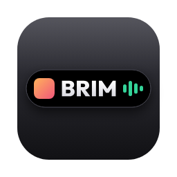
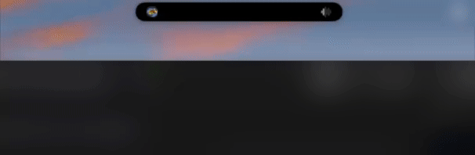
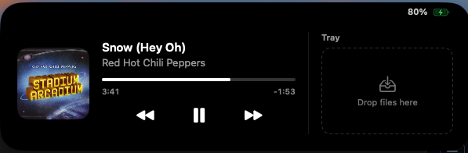

<p align="center"></p>

# Brim

A free, open-source Dynamic Island for MacBooks. Brim turns the notch into a live strip for media, files and battery status, and puts Now Playing on your lock screen.

> **Status: v0.5, early development.** See [the roadmap](docs/ROADMAP.md) and [changelog](CHANGELOG.md).

<p align="center">
  
</p>

## Features

- **Hover to open.** The notch expands into an island and closes as soon as the pointer leaves.
- **Now Playing.** Artwork, title, artist, a scrubber and controls for Apple Music, Spotify, Tidal and browser players. While music plays, the closed island shows the artwork and a live waveform.
- **File tray.** Drag files onto the notch to hold them, then drag them out wherever you need them. Double-click to open; the tray survives restarts.
- **Battery.** A brief charging notice when you plug in, low-battery alerts at 20% and 10%, and the battery level in the open island.
- **Lock screen.** Now Playing with controls, a song progress bar and your battery level, before you log in. Brim can keep the lock screen lit while music plays (or always), instead of macOS turning it off after about 30 seconds.

<p align="center">
  <br>
  <em>The open island: Now Playing, the file tray and battery level.</em>
</p>

<p align="center">
  <br>
  <em>While music plays, the closed island shows the artwork and a live waveform.</em>
</p>

<p align="center">
  <br>
  <em>Plugging in shows a brief charging notice. (These two are on an external display; on a MacBook they sit either side of the notch.)</em>
</p>

## Requirements

- macOS 26 Tahoe or later
- A Mac with Apple silicon. Notched MacBooks get the full effect; on other displays Brim floats a pill just below the top centre of the screen, hidden until you hover there or something is playing.

Brim asks for no permissions: no Accessibility, Screen Recording or Automation access.

## Install

Pick **one** of these. Both give you the same app.

### Option 1: Download the DMG

1. Go to [Releases](https://github.com/ieralyte/brim/releases) and download the latest `Brim-<version>.dmg`.
2. Open the DMG and drag **Brim** onto **Applications**.
3. Eject the DMG, then follow [First launch](#first-launch) below.

### Option 2: Homebrew

```sh
brew install --cask ieralyte/brim/brim
```

Then follow [First launch](#first-launch) below.

## First launch

Brim is free and isn't notarized by Apple (that needs a paid developer account), so macOS blocks it the first time you open it. You only do this once per version.

1. Open **Brim** from Applications. macOS says it can't verify the developer. Click **Done** (not Move to Bin).
2. Open **System Settings → Privacy & Security**, scroll down to the Security section and click **Open Anyway** next to the Brim message.
3. Click **Open Anyway** again in the dialog and enter your password or use Touch ID.

<details>
<summary>Prefer Terminal?</summary>

This removes the download quarantine flag, which has the same effect as **Open Anyway**:

```sh
xattr -dr com.apple.quarantine /Applications/Brim.app
open /Applications/Brim.app
```
</details>

## Using Brim

Brim has **no Dock icon and no window** when it starts. That's normal.

- **Hover over the notch** to open the island. Move the pointer away to close it.
- **Settings and Quit** are in the menu bar icon (a small rectangle with a filled top). On a busy menu bar, macOS can hide icons behind the notch; quit a few other menu bar apps if you can't see it, or hold **⌘** and drag other icons out of the way.
- **Lock screen** options (show on lock screen, keep the screen on while locked) are in Settings. **Settings → Diagnostics** shows whether Now Playing and the lock screen are working on your Mac.
- **Start at login:** turn on **Start Brim at login** in Brim's Settings. It then appears under **System Settings → General → Login Items & Extensions**, where you can also turn it off.

## Update

- **DMG:** quit Brim from the menu bar, download the new DMG and drag Brim to Applications, replacing the old copy. Then repeat [First launch](#first-launch) once.
- **Homebrew:** `brew upgrade --cask brim`, then repeat [First launch](#first-launch) once.

## Uninstall

1. Quit Brim from its menu bar icon.
2. Drag **Brim** from Applications to the Bin, or run `brew uninstall --cask brim` if you used Homebrew.
3. Optionally remove its settings and file tray list: `defaults delete io.github.brim.Brim` (Homebrew users can use `brew uninstall --zap --cask brim` to do steps 2 and 3 together).

The file tray only holds references, so your files themselves are never touched.

## Troubleshooting

| Problem | Try this |
| --- | --- |
| "Brim is damaged and can't be opened" or the app won't open at all | Use the Terminal command under [First launch](#first-launch). |
| Nothing happens when I hover over the notch | Check Brim is running (menu bar icon). With the lid closed or on an external display there is no notch: hover the top centre of the main display and the island opens there. It stays hidden while idle. |
| Now Playing is empty | Start playback in the player app first, then check **Settings → Diagnostics**. A macOS update can break the private API it relies on; the rest of Brim keeps working. |
| Nothing on the lock screen | Make sure **Show on lock screen** is on in Settings and check **Settings → Diagnostics**. |

If none of that helps, [open an issue](https://github.com/ieralyte/brim/issues) with your macOS version and what Diagnostics shows.

## Build from source

You need **Xcode 26 or later** (free from the App Store). No Apple Developer account is needed: the project signs locally ("Sign to Run Locally"), and apps you build yourself don't trigger the [First launch](#first-launch) prompt.

### Run from Xcode

```sh
git clone https://github.com/ieralyte/brim.git
cd brim
open Brim.xcodeproj
```

Choose the **Brim** scheme and **My Mac**, then press **Run** (⌘R). Brim appears in the menu bar; hover over the notch. Stopping the run in Xcode quits Brim.

### Build a standalone copy

To keep using Brim after closing Xcode, build a Release copy and put it in Applications:

```sh
xcodebuild -project Brim.xcodeproj -scheme Brim -configuration Release -derivedDataPath build build
rm -rf /Applications/Brim.app   # remove an older copy, if you have one
cp -R build/Build/Products/Release/Brim.app /Applications/
open /Applications/Brim.app
```

Or run `scripts/make-dmg.sh` to build the same DMG the releases use; it lands in `dist/`.

If `xcodebuild` says it requires Xcode but only the Command Line Tools are selected, point it at Xcode first: `sudo xcode-select -s /Applications/Xcode.app`.

## Project layout

```
Brim/
  App/                  Entry point, app delegate, Settings window
  Notch/                The notch panel, its shape, hover logic and state
  Features/NowPlaying/  Now Playing service and views
  Features/FileTray/    File tray service and views
  Features/Battery/     Battery service, alerts and indicator
  LockScreen/           Lock screen card and the window that holds it
  Platform/             Display wake assertion
  Platform/Private/     The only place private Apple APIs are allowed
  Resources/            Bundled resources (the media adapter's Perl loader)
Vendor/
  MediaRemoteAdapter/   Third-party adapter source, built as an embedded framework
scripts/make-dmg.sh     Builds, ad-hoc signs and packages a DMG
```

## How it works

- A borderless `NSPanel` sits above the menu bar on every Space, including full-screen apps.
- Global `NSEvent` mouse-move monitors detect when the pointer reaches the notch; no Accessibility permission is needed.
- The island is a SwiftUI view whose size and corner radii animate with a spring.
- While closed, the panel ignores the mouse, so clicks pass straight through to the menu bar.
- When a file drag reaches the notch, Brim notices it on the drag pasteboard and opens the island as a drop target.
- The tray stores bookmarks, not copies, so files can move or be renamed and still resolve.
- Battery updates come from IOKit power-source notifications; nothing polls.
- **Lock screen** uses Apple's private SkyLight window server API, following [SkyLightWindow](https://github.com/Lakr233/SkyLightWindow): Brim creates a window-server space at the level macOS uses for lock screen notifications and moves its card into it when the screen locks. Every private call is looked up at runtime, so if macOS removes one, the feature switches off and Settings says so.
- **Now Playing** comes from Apple's private MediaRemote framework. Since macOS 15.4 it only answers Apple-signed processes, so Brim uses [mediaremote-adapter](https://github.com/ungive/mediaremote-adapter): a small framework loaded by the system's `/usr/bin/perl`, which streams updates back as JSON. It works with Apple Music, Spotify, Tidal and browser players. If a macOS update breaks it, Settings shows Now Playing as unavailable and the rest of Brim keeps working.

## Contributing

Issues and pull requests are welcome. Please keep private-API code inside `Platform/Private/`, behind a protocol, so a macOS update can only disable a feature, never crash the app.

## Releasing

For maintainers. Releases are built by GitHub Actions (`.github/workflows/release.yml`) whenever a version tag is pushed:

1. Bump `MARKETING_VERSION` for the Brim target and add a section for it to `CHANGELOG.md`.
2. Commit, then tag and push: `git tag -a vX.Y.Z -m "Brim X.Y.Z" && git push --follow-tags`.
3. The workflow builds and ad-hoc signs Brim, packages a DMG, publishes a GitHub Release with the changelog notes, and updates the cask in [homebrew-brim](https://github.com/ieralyte/homebrew-brim).

The tap update needs a `TAP_TOKEN` repository secret: a fine-grained personal access token with **Contents: read and write** on `homebrew-brim`. Without it, releases still publish but the tap step is skipped, and Homebrew users stay on the old version. To redo a release for an existing tag, run the workflow manually from the Actions tab and enter the tag.

## Acknowledgements

Inspired by [Canopy](https://getcanopy.pro/). Brim is an independent project, not affiliated with Canopy, and shares none of its code or assets.

The app icon's lettering is set in [Outfit](https://github.com/Outfitio/Outfit-Fonts) (SIL Open Font License, see [`design/OFL-Outfit.txt`](design/OFL-Outfit.txt)); the icon sources are in [`design/`](design).

Brim bundles [mediaremote-adapter](https://github.com/ungive/mediaremote-adapter) by Jonas van den Berg and contributors (BSD 3-Clause, see [`Vendor/MediaRemoteAdapter/LICENSE`](Vendor/MediaRemoteAdapter/LICENSE)), vendored from commit `0e82bf1`. The lock screen technique is adapted from [SkyLightWindow](https://github.com/Lakr233/SkyLightWindow) by Lakr Aream (MIT License).

## Licence

[MIT](LICENSE) © 2026 Tan Wei Jian. Third-party code keeps its own licence (see Acknowledgements).
